# Replayer chips: 20 alternative designs

Twenty ways the replayer's 3D chips could be drawn instead, from a small fix to today's chip to a different idea of what a chip on the felt is for. Nothing has been built. The table and pictures are in [README.md](README.md); the one-page gallery is `gallery.html`.

## Today

What the replayer draws now, read from `vite-app/src/components/HandReplayerView.jsx` (`CHIP_DENOMS`, `getChipBreakdown`, `ChipStack`, `PotChipVisual` / `PotChipLive`, `pipShift`) and `vite-app/src/styles.css` (`.chip-disc, .replayer-pot-chip-disc`, about line 1149; `.replayer-flying-chip.denom`, line 1235; `.replayer-pot-chips`, line 7707), and measured in WebKit at 402 x 874 on a share link (`00-today-app.jpg`).

- **One element per chip, drawn as a cylinder.** Width W, height E + h, where E = 0.724 W is the top face's ellipse (the viewing angle, measured off a reference photo) and h = 0.236 W is the edge that shows; the vertical corner radius is E/2, so top and bottom are elliptical arcs with h of straight side between.
- **The edge:** the chip's colour, twelve dark notches round it (black at 30%, each 7% of the width, six across the front), and a vertical shade from white 16% at the top to black 55% at the bottom, which draws the groove where it meets the chip below. Each chip's notches are turned by `pipShift(amount, index)`, a hash of the amount, so a wager looks the same every time and scrubbing never reshuffles it.
- **The face** (`::before`): inset 8% so the notches show round it as a rim, a radial highlight (white 30% at 50% 35%) and a white 22% ring. No logo or figure.
- **Shadow:** one small drop shadow per disc (0, 0.125 r, blur 0.25 r, black 35%). Nothing on the felt under a stack.
- **Stacking:** each chip below the top is pulled up by E, so only its h of edge shows; the top chip paints last.
- **Size:** wager discs `--disc-w: clamp(9px, 2.4cqmin, 20px)`, 9.1 px across on a phone; pot discs `clamp(8px, 3cqmin, 32px)`, 11.4 px. A board card is 34.8 px wide, so a wager's chip is a quarter of a card and the pot's a third.
- **Colours** (`CHIP_DENOMS`): 25,000 teal #14b8a6, 5,000 orange #f97316, 1,000 yellow #eab308, 500 violet #7c3aed, 100 navy #39406b, 25 green #22c55e. The app's own system, not a casino's.
- **How many:** `getChipBreakdown` is greedy, biggest first, **at most five chips in all**. A wager is one column with the biggest on top (12,000 = 5K 5K 1K 1K). The pot is one column per colour, at most five columns and six chips a column, keyed by colour so the sweep can land on its stack (38,000 = one 25K, two 5K, two 1K; the third 1,000 is dropped by the cap).
- **Where:** a wager sits inside the `.replayer-bet-chip` pill, left of its number; the pot's row stands above the POT figure. In flight the sweep and the ship move `.replayer-pot-chip-disc` ghosts; `.replayer-flying-chip.denom` is a 2.25 r sphere shaded with inset shadows.
- **Felt** (default theme, dark): `rgb(39,34,42)` at the centre to `rgb(20,18,32)` at the rail; light and cloudy use `#9b8dc0` to `#423a5b`.

What follows from that: at 9 px the notches are under a device pixel, so on a phone a chip reads as a coloured lozenge with a highlight; the navy 100 is darker than the felt; and the five-chip cap means a stack's height says little about the amount.

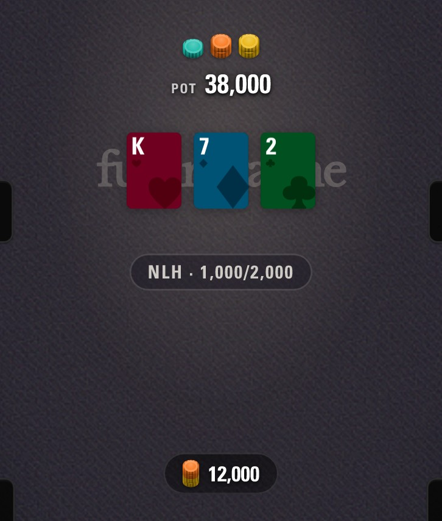

## How to read a picture

Each picture is one option drawn three ways, on the dark felt's own colours:

- **Phone size, 1:1** (left): the pot (38,000) above two board cards for scale, and a wager pill (12,000) below, at the sizes the option proposes (today: 9.1 px wager chips, 11.4 px pot chips, 34.8 px cards). Under it the same wager on the light and cloudy themes' felt.
- **Enlarged** (right): one chip, the 12,000 wager and the 38,000 pot, at about four times phone size, so the drawing can be judged.

The mockups are standalone SVG drawn for this catalogue (not app code), screenshotted in Playwright WebKit at 3x. Nothing here is built.

## The options

### 1. Casino clay: white edge inserts, an inlay on the face

Effort: **M**

The real tournament chip: each chip carries six white rectangular inserts round its edge, and they show on the stack as white blocks on the side and as a broken white ring on the top face, with a lighter inlay in the middle. The cylinder is lit from the left, so the side reads round instead of as a band.

**What it fixes:** Today's edge marks are dark notches on a dark chip, which disappear below 12 px; white inserts are the highest-contrast detail a chip can carry and read even at 9 px as "a casino chip".

**Trade-off:** More gradient stops per disc (a pot of 25 discs is about 75 layers). Inserts on a white or yellow chip need a darker insert colour, a per-denomination exception.

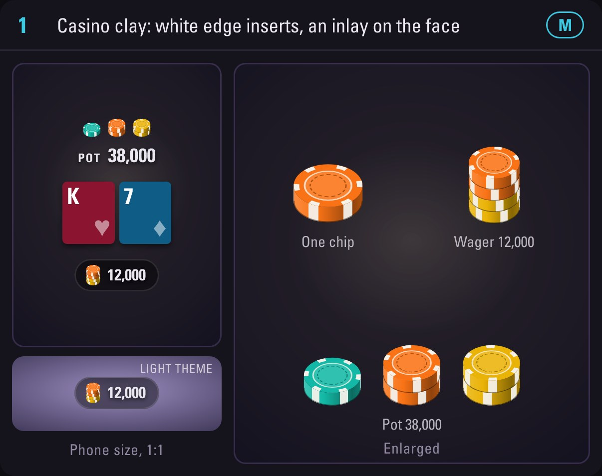

### 2. Top view: the chip seen from above, stacks shingled

Effort: **M**

Drop the side view. Every chip is a full circle seen from straight above, six edge spots and a dashed inner ring, the way online rooms draw them; a stack is the same circle repeated a sixth of a chip lower each time, like chips pushed out in a short slide.

**What it fixes:** A circle is the largest a chip can be in its box: at the same width the face is 38% bigger than today's ellipse, so colour and spots carry twice the area.

**Trade-off:** Loses the feeling of height: a stack of five looks like a smear rather than a column. Breaks the measured perspective the felt and cards were tuned to.

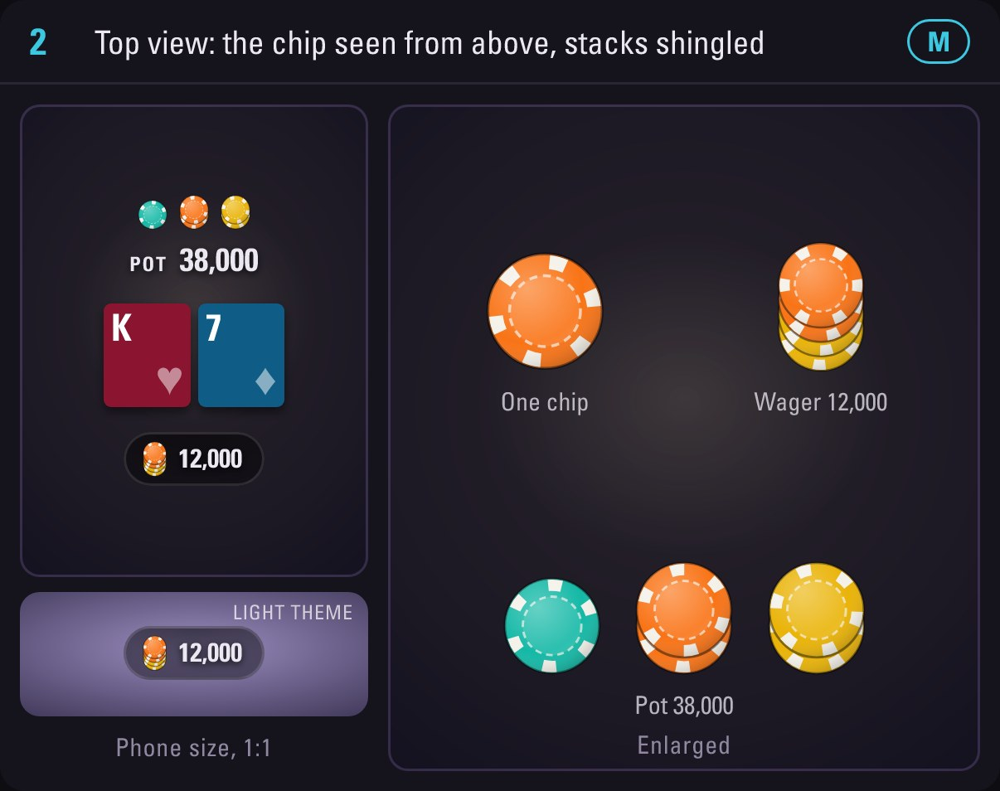

### 3. Ceramic: the value printed on the face

Effort: **M**

A ceramic chip has a printed face: a cream disc in the middle with the denomination ("5K", "1K", "25K") in the chip's own colour. Only the top chip of a stack shows its figure. The pot's chips grow to 14 px so the figure there is legible.

**What it fixes:** Colour alone asks the viewer to know that orange is 5,000; the figure says it. Good for a shared hand whose viewer never learned the colours.

**Trade-off:** At 9 px the figure is a speck, so on the wagers it is decoration; the pill's number already says the amount. The cream centre makes every chip look partly white.

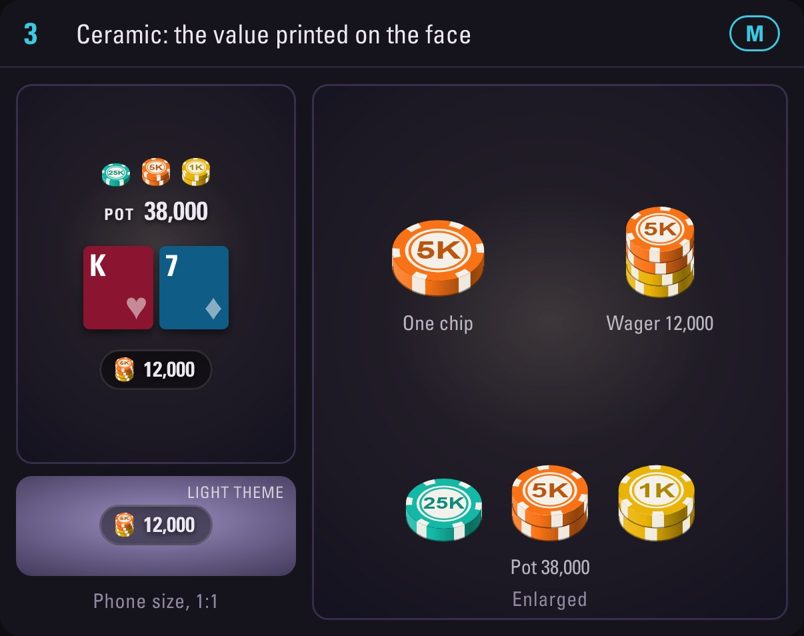

### 4. Minimal flat disc

Effort: **S**

Two flat colours per chip: the side, and a face one step lighter. No notches, no gradients, no ring. A stack is a column of clean bands.

**What it fixes:** The cheapest chip to draw and to animate, and the closest to the rest of the felt's flat plaques and pills. Nothing in it can alias or shimmer during a flight.

**Trade-off:** Loses "clay"; reads as a chart token. Two adjacent chips of the same colour merge into one block because there is no groove between them.

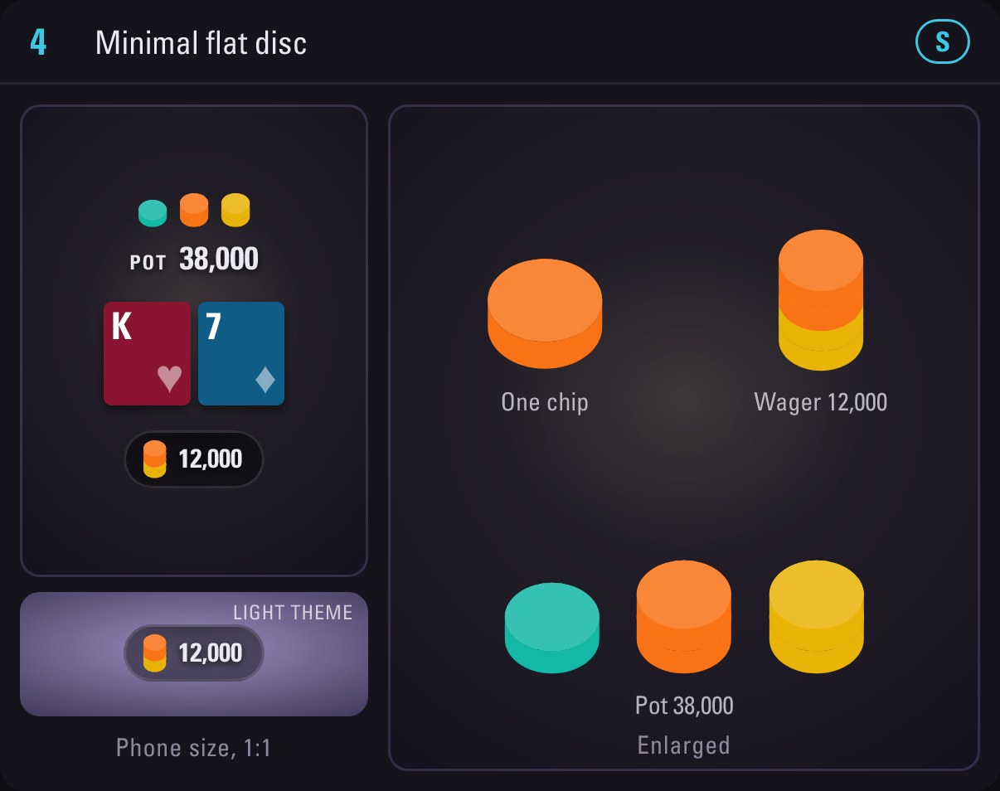

### 5. Outlined: the chip drawn in its colour as a line

Effort: **S**

Each chip is an outline in its denomination colour over a darkened fill, with an inner ring; the felt shows through. It matches the app's outlined pills and the action badges (CHECK).

**What it fixes:** Line colour on a dark ground has more contrast than a filled dark chip (the navy 100 chip disappears today), and an outlined stack stays light on a busy felt.

**Trade-off:** Thin lines at 9 px are 1 device pixel and can fall between pixels on a 2x screen. On the light theme's felt the dark fill looks like a hole.

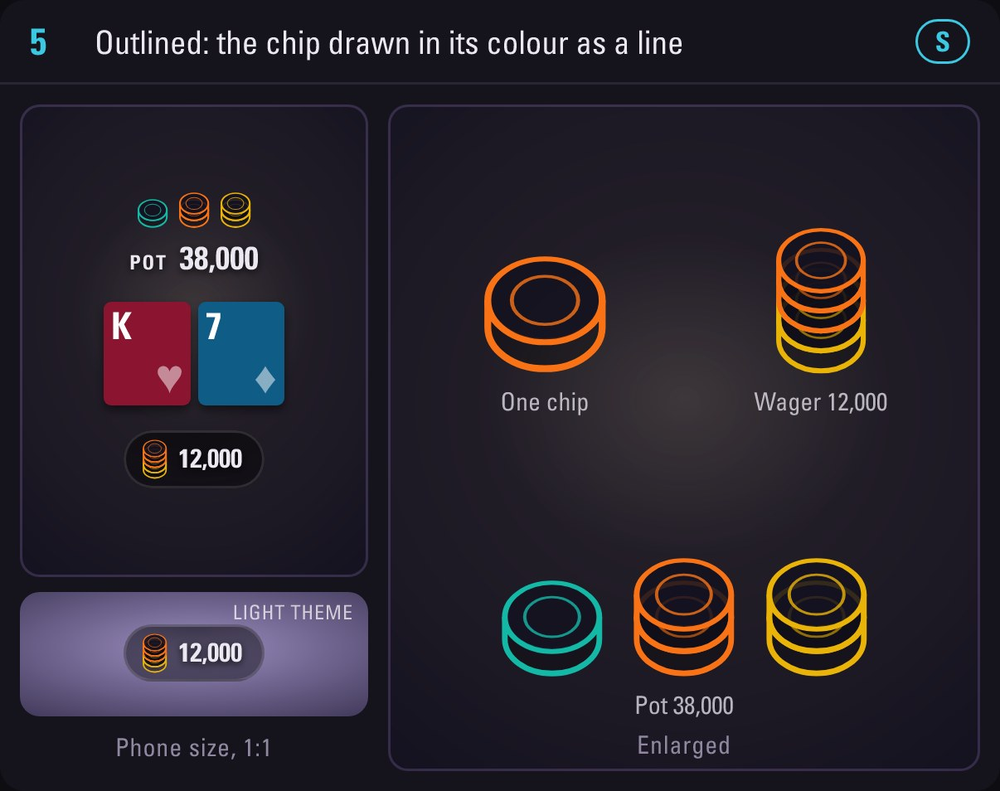

### 6. Metal: coins for small values, a plaque for the biggest

Effort: **L**

The colour system becomes materials: bronze 25, copper 100, silver 500, gold 1,000, rose gold 5,000, each a coin with a reeded edge, and the 25,000 is a rectangular platinum plaque, as high-roller rooms use. Value reads from the shape and the metal, not from a learned colour.

**What it fixes:** The biggest denomination becomes a different shape, so a big pot is visible at a glance; metals separate by brightness, which colour-blind viewers keep.

**Trade-off:** A plaque does not stack with coins, so the pot needs a second layout. Metal sheen needs gradients that the GIF export quantises badly. Large effort: new pot layout, new flight sprite.

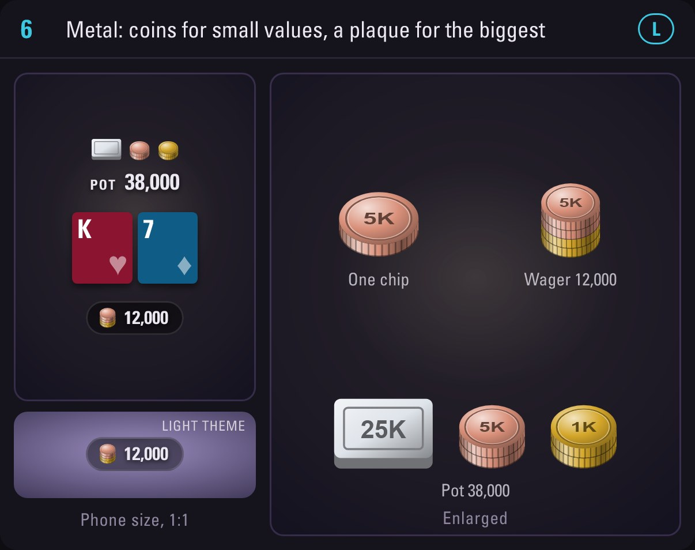

### 7. Chips counted true, up to ten a stack

Effort: **S**

Today a wager is never more than five chips in all, so 12,000 and 30,000 can look alike. Draw the real breakdown, up to ten chips a stack, and when a stack would be taller the top chip carries a small "+".

**What it fixes:** A bigger bet looks bigger, which is the whole point of drawing chips. 38,000 shows its three 1,000s, which the five-chip cap drops today.

**Trade-off:** Tall stacks collide with the cards on a phone (ten chips is 2.7 g at the wager size). A breakdown of many small chips (24,975) looks like a lot of money.

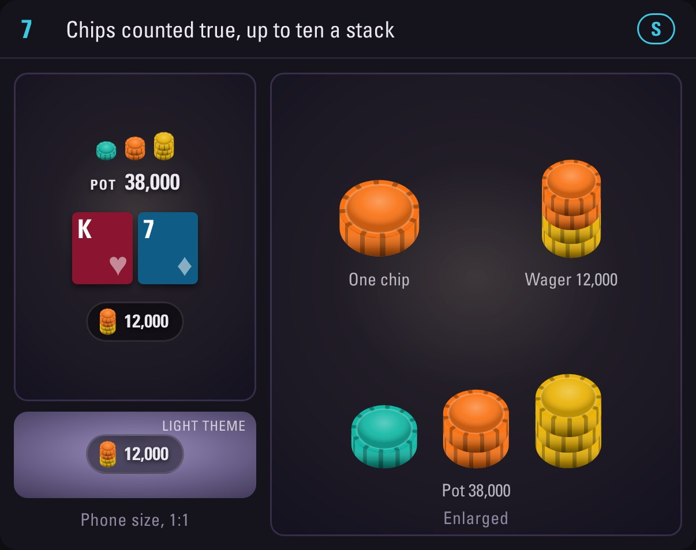

### 8. Height in big blinds, one colour

Effort: **M**

Chips stop encoding denominations. Every chip is the same ivory chip worth one big blind; a stack is the wager in big blinds, up to ten a stack, so stacks of two seats compare by height. The pill keeps the exact number.

**What it fixes:** Players think in big blinds; a 6 bb bet is six chips at every level of every tournament, where today the same bet is a different set of colours at each level.

**Trade-off:** Loses colour on the felt entirely, which some will miss. Deep pots need several stacks (a 60 bb pot is six) or a cap with a figure.

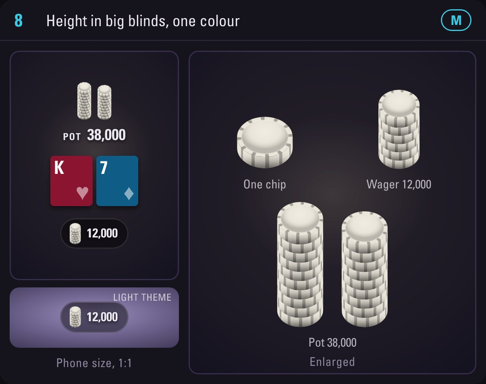

### 9. Casino standard colours

Effort: **S**

Keep today's chip and change its colours to the ones every card room uses: green 25, black 100, purple 500, yellow 1,000, red 5,000, grey 25,000, each with white edge inserts.

**What it fixes:** A live player reads these without learning: black is 100, purple is 500. Today's teal 25,000 and orange 5,000 are the app's own and mean nothing at a table.

**Trade-off:** Black and purple chips on a dark purple felt are the worst pair for contrast, so this needs the keyline (16) or the inserts to stay legible.

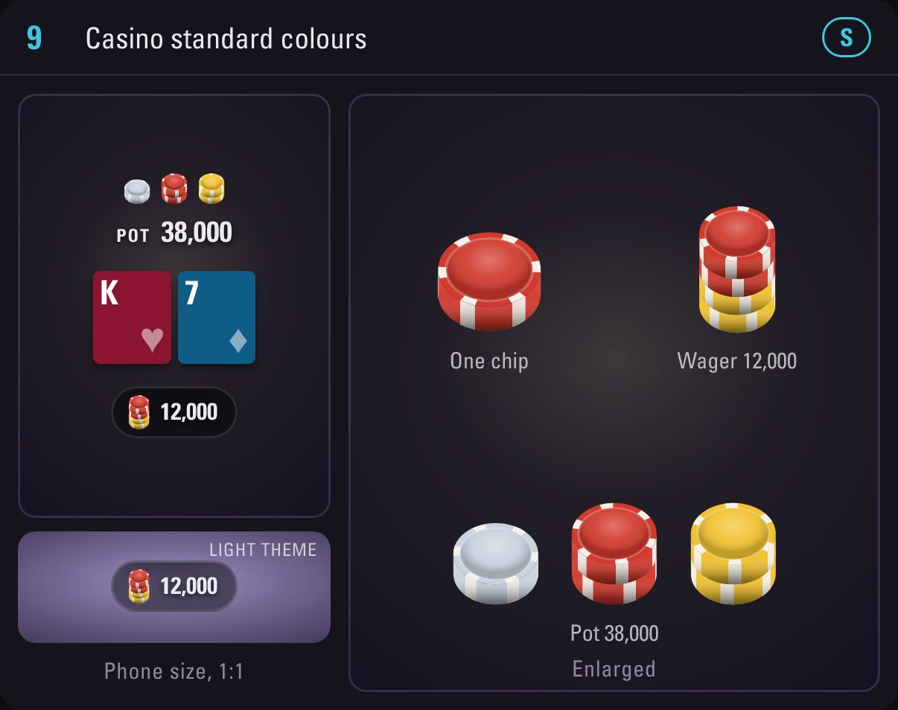

### 10. Brand palette, value by lightness

Effort: **S**

The chips take the app's own colours: deep navy 25, indigo 100, violet 500, the brand cyan 1,000, ice 5,000, ivory 25,000. Value climbs with lightness, so the bigger the chip the brighter it is.

**What it fixes:** The felt stops looking like a different app from the plaques and controls; and brightness is an order a viewer reads without a key, including in greyscale.

**Trade-off:** A one-hue ramp is harder to tell apart chip by chip than six unrelated hues. The 25 and 100 are close to the felt and need the keyline.

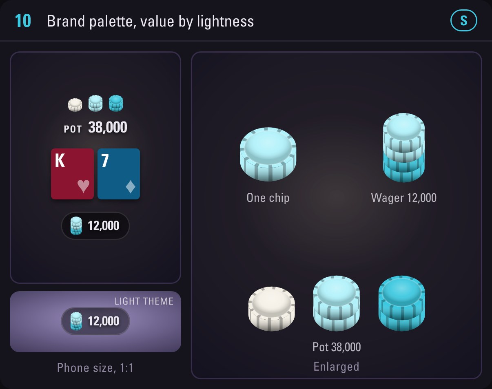

### 11. Deeper 3D: thicker chips under the lamp

Effort: **M**

A lower viewing angle (face 0.55 of the width, edge 0.3), cylinder shading from the left and a specular spot on the top face where the felt's lamp is. Fewer chips needed for the same height.

**What it fixes:** Today's chip is so thin and so foreshortened that a stack of two reads as one chip; a thicker edge makes every chip count.

**Trade-off:** A steeper perspective than the cards' and the plaques' (which are flat), so the chips look like they belong to another table. Taller stacks, less room.

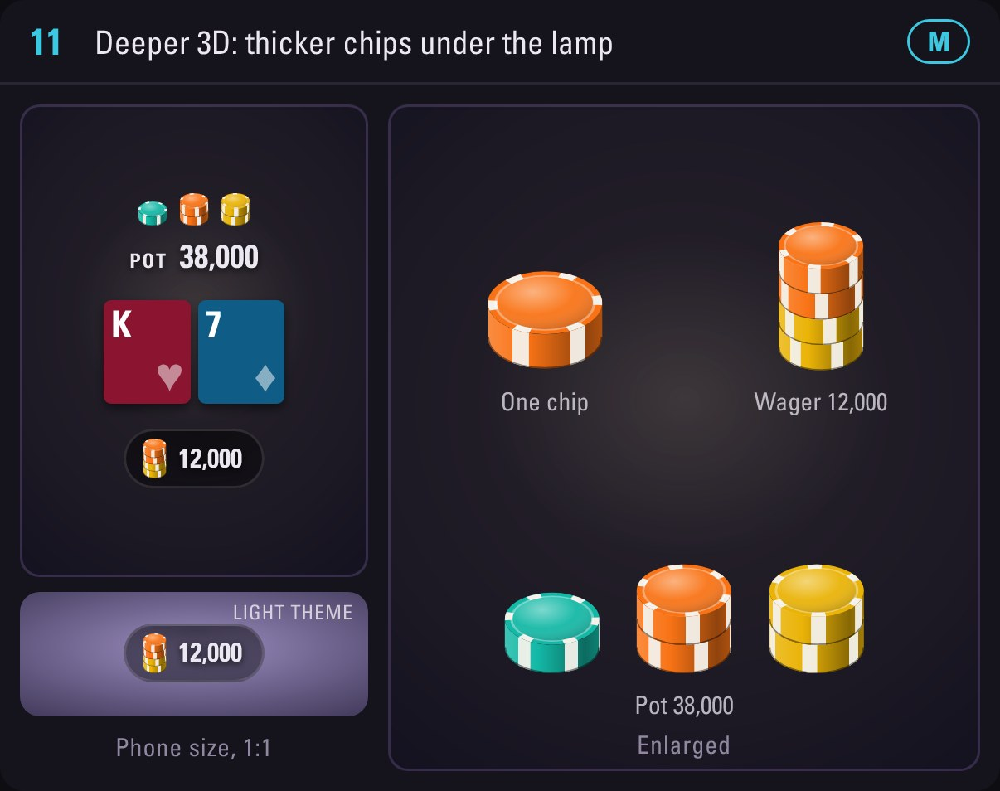

### 12. Pure side view: a stack of bars

Effort: **S**

No face at all: each chip is a rounded bar seen edge-on, with three white insert marks and a hairline gap between chips. A stack is a short bar chart of chips.

**What it fixes:** Every chip is fully visible, so a stack of four shows four colours at any size; nothing overlaps. The most legible stack at 9 px.

**Trade-off:** Flat and diagrammatic; the felt's cards and lighting are drawn in perspective, these are not. A single chip is a dash and looks like nothing.

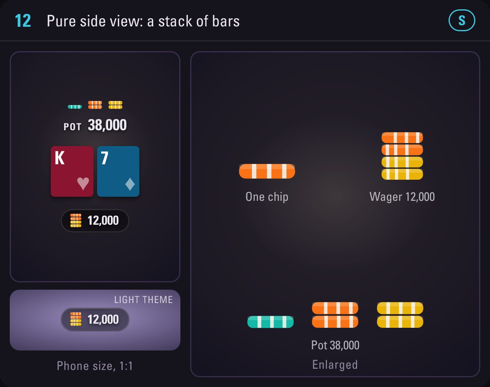

### 13. One token per wager

Effort: **S**

A wager is one larger chip (14 px) in the colour of its biggest denomination beside the number; the pot is one 18 px chip. No stacks anywhere: the number carries the amount.

**What it fixes:** The cleanest felt, the cheapest motion (one element flies, not five), and a chip big enough to show its edge spots on a phone.

**Trade-off:** Gives up showing size at all: a min-bet and a shove are the same token. The pot loses its sense of growing.

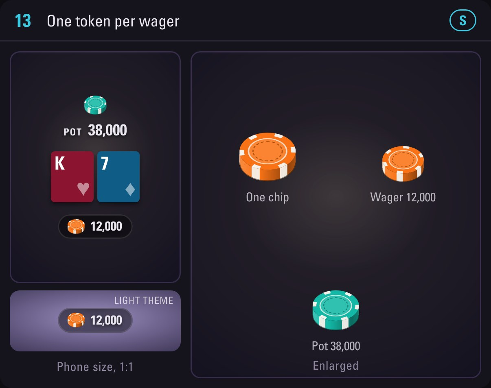

### 14. Today's chip, set on the cloth: a contact shadow and the lamp

Effort: **S**

Keep the chip; add what places it: a soft elliptical shadow on the felt under each stack, and a warm highlight on the top face from the same lamp that lights the felt's centre.

**What it fixes:** Today's chips float: the only shadow is a 1 px drop under each disc. A contact shadow sits the stack on the cloth and makes landings read in motion.

**Trade-off:** A shadow per stack, so the pot's five stacks add five blurred layers; in the GIF export a soft shadow bands.

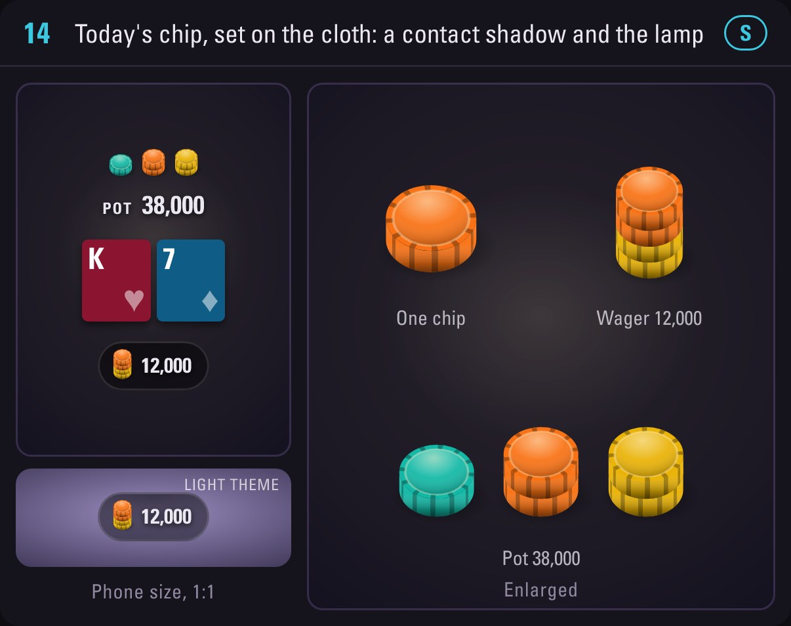

### 15. Acrylic: translucent chips that glow

Effort: **M**

Clear coloured acrylic, like modern tournament chips: the side is translucent, the face carries a bright rim and a white inner ring, and the colour lights up rather than shades down.

**What it fixes:** Glowing colour reads on a dark felt where opaque dark chips sink; it suits the app's dark themes and the neon of the active seat.

**Trade-off:** Translucency shows the chips below through the stack, which muddies colours. Unlike any real chip a player handles.

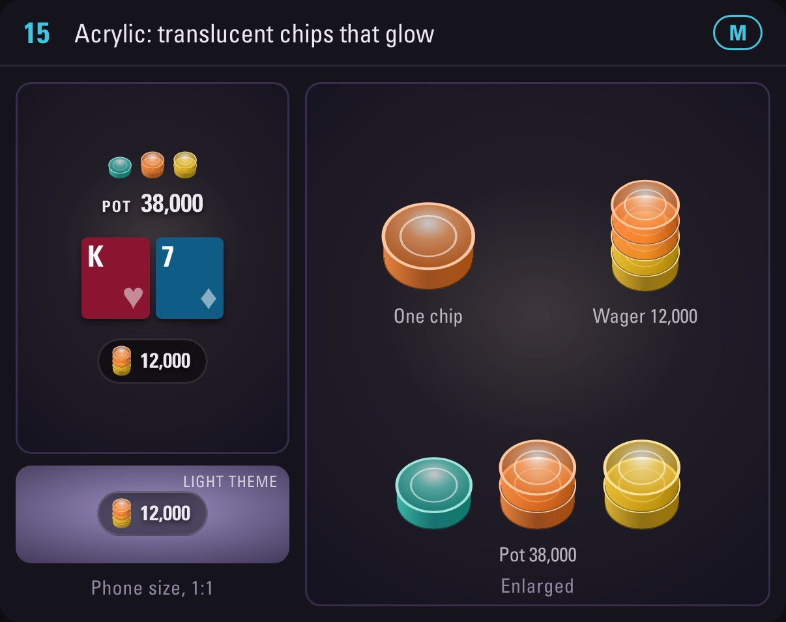

### 16. A keyline for dark felt

Effort: **S**

Today's chip with a hairline light outline round the silhouette of each chip, and the 100 lifted from #39406b to #5a63a3 so it is no longer darker than the felt.

**What it fixes:** The navy 100 chip has less contrast with the felt than the felt's own rail; on the light theme's felt (bottom strip) it is the only chip you cannot see.

**Trade-off:** A white outline on every chip makes the stack look drawn rather than lit. Small change to one colour token.

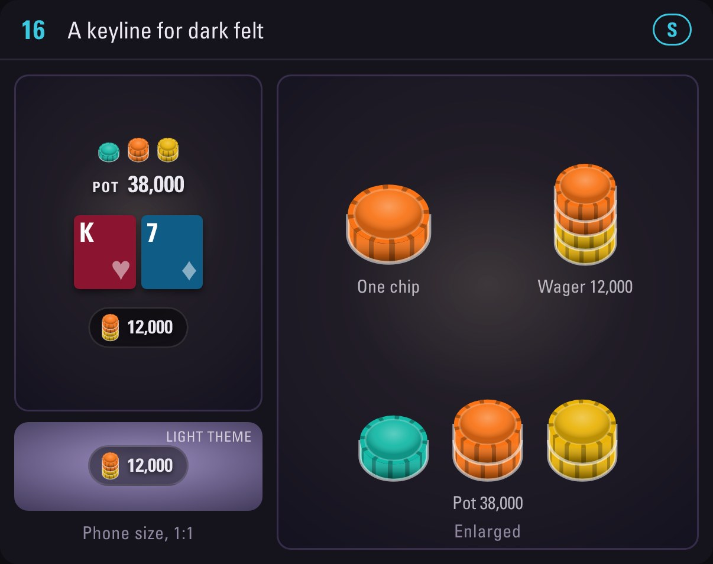

### 17. Sized to the card: chips half a card wide

Effort: **S**

Today a wager's chip is 9 px, a quarter of a board card (35 px). Make it half a card (17 px) and the pot's 20 px, and keep everything else as it is.

**What it fixes:** At 9 px nothing in the chip's careful drawing survives: the notches are under a pixel. At 17 px the edge marks, the groove and the face ring all show.

**Trade-off:** Bigger stacks need room the phone layout does not have: the wager pill grows by 8 px and the pot stacks reach the top seat sooner.

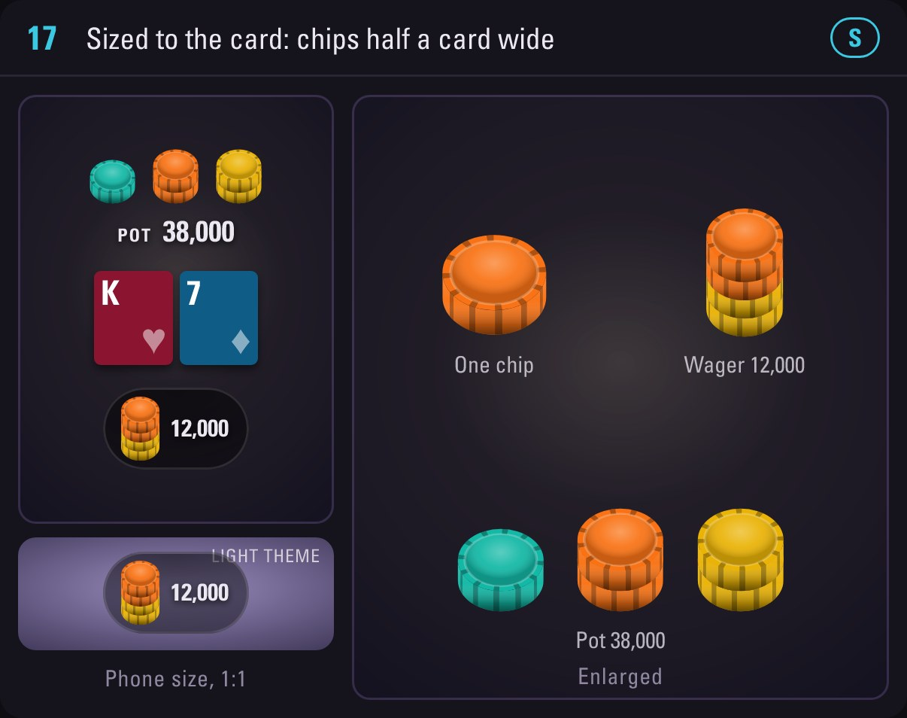

### 18. A pushed stack, not a column

Effort: **S**

Each chip sits a few percent off the one below, left or right, decided by the amount (like the edge marks' rotation, so it never reshuffles). A wager looks like chips a player slid out, not a machined cylinder.

**What it fixes:** Shows the chip count: offsets reveal every chip's edge, where a perfect column reads as one tall chip. Adds life to the felt at no cost.

**Trade-off:** An untidy felt; reads as messy beside the strict grid of plaques. The pot's stacks should stay neat or the row looks careless.

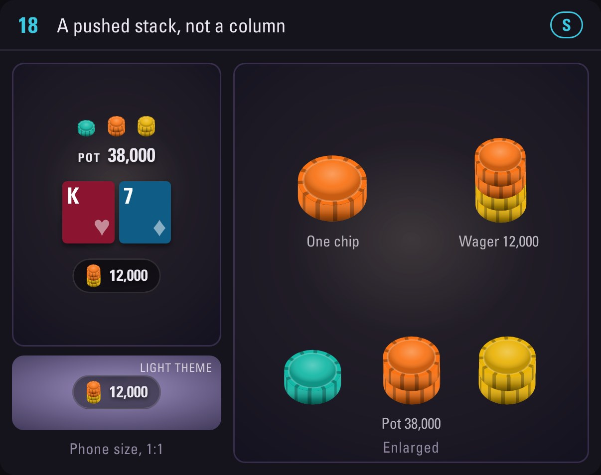

### 19. Built for motion: four bold quarters that read as a spin

Effort: **M**

The chip's edge has four wide white quarters, not twelve fine notches, so when a chip turns in flight the rotation is visible; a stack is drawn as one element whose quarters shift by the amount.

**What it fixes:** Today's fine notches shimmer and alias when a chip moves, and a spinning chip with twelve marks looks still. Four marks give the eye something to follow.

**Trade-off:** Bold quarters are louder at rest. The pattern repeats every 90 degrees, so a spin must be slower than a quarter-turn a frame or it strobes.

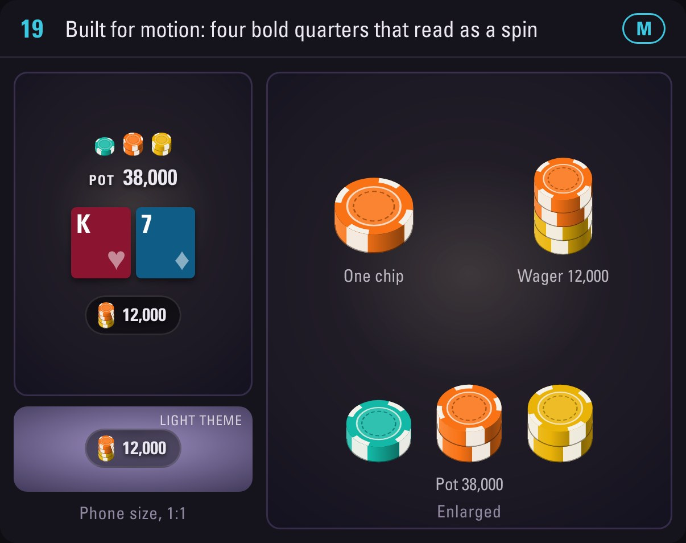

### 20. The pot as a pile, the wagers as stacks

Effort: **L**

Wagers stay as neat stacks in front of the seats; once swept, the pot becomes a loose pile: short stacks of different heights leaning together, with a couple of chips lying flat in front, as chips land when a dealer pulls them in.

**What it fixes:** Separates the two kinds of money at a glance: what a player has put out (stacks) and what is in the middle (a pile). A growing pile is the best picture of a growing pot.

**Trade-off:** Needs a new pot layout and new landing positions for the sweep and ship springs; harder to keep stable as the amount changes. Large effort.

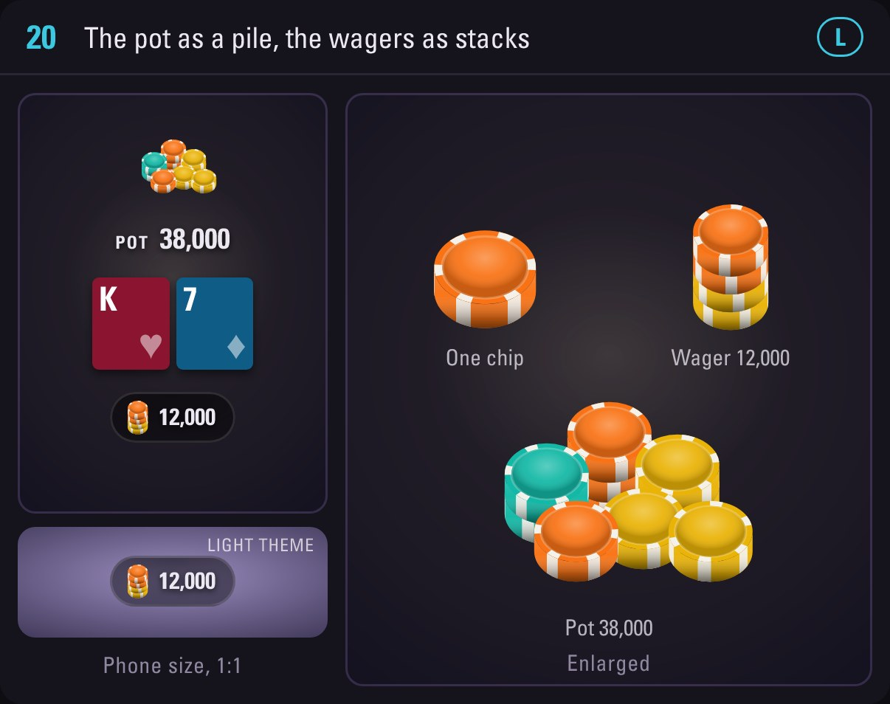

## Combinations worth noting

- 16 (keyline) is needed by 9 (casino colours) and 10 (brand palette) on the dark felt.
- 14 (contact shadow) and 17 (half a card wide) go with any chip drawing.
- 7 (true count) or 8 (height in big blinds) decides what a stack means; every other option decides how a chip looks. One from each group can be combined.
- 13 (one token) and 19 (spin-ready) are the two that make motion cheapest.
